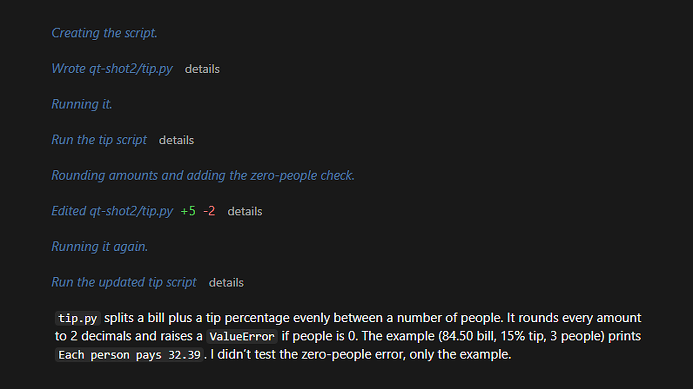

# quiet-transcript

A Claude Code mod that turns down everything in the transcript except Claude's answers.



The text Claude writes before a tool call, the tool calls themselves, grouped reads and searches, and slash-command output are drawn in a faint, tinted italic. The answer that ends each turn keeps its normal look, older ones further up included. Added and removed line counts stay green and red, and a failed call still says "failed" in red.

Each quieted tool line has a **details** button that brings back the app's own card with the full output and diff. **hide details** folds it away again.

It works in the Code tab of the Claude desktop app and in the terminal.

## Install

At the prompt of a terminal session:

```
/plugin install quiet-transcript --marketplace kevlar10x/quiet-transcript
```

Answer `y` to add the marketplace, then pick the user scope.

From a shell:

```bash
claude plugin install quiet-transcript --marketplace kevlar10x/quiet-transcript
```

In the desktop app, where `/plugin` doesn't run: click **+** next to the prompt box, then **Plugins**, **Add marketplace** with `kevlar10x/quiet-transcript`, then **Add plugin**.

## What changes

| Part of the transcript | How it's drawn |
|---|---|
| Claude's answer | As before |
| Text written before a tool call | Faint tinted italic |
| A tool call | One faint line, such as `Edited src/app.ts +2 -1`, with a details button |
| A group of reads and searches | One faint line, such as `Read 2 files, searched 1 pattern`. The desktop app keeps its own collapsed row, such as `Used 3 tools`. |
| Slash-command output | Dimmed. Errors are left as they are. |

Your own messages, Claude's question cards, background-task notices and the "working" indicator are left alone.

## Privacy

The mod reads the messages of the session it runs in to tell narration from answers. For the rest of that session it keeps short hashes of the narration paragraphs and a note of which tool lines have their details open. It makes no network requests and writes no files.

## Uninstall

```bash
claude plugin uninstall quiet-transcript
```

## License

MIT

If you'd like to leave a tip: https://ko-fi.com/kevlar10x
